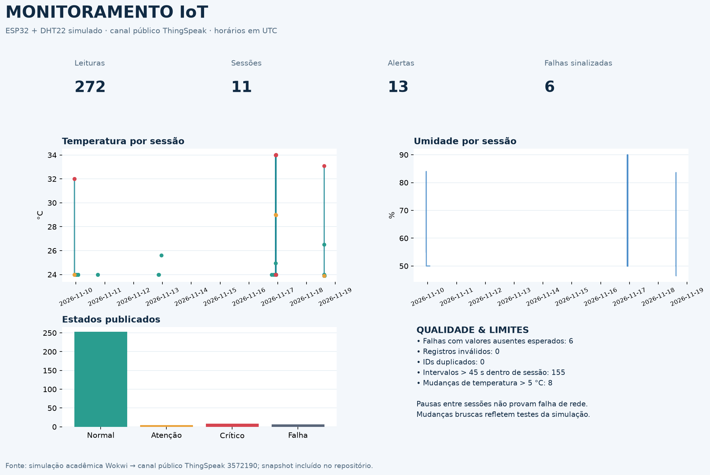

# Monitoramento e análise de dados IoT



Este projeto analisa as leituras do [canal público ThingSpeak 3572190](https://thingspeak.mathworks.com/channels/3572190), alimentado pelo [ESP32 e DHT22 simulados no Wokwi](https://wokwi.com/projects/480253237161186305) em uma atividade acadêmica em equipe. **Não são medições de um ambiente físico real.** Esta análise é uma extensão independente do projeto de simulação: não altera o firmware nem o canal.

## Perguntas respondidas

- Quantas leituras foram classificadas como normal, atenção, crítico ou falha?
- As falhas foram enviadas com temperatura e umidade ausentes, como previsto pela simulação?
- Houve registros inválidos, IDs repetidos, intervalos longos dentro de sessões ou mudanças rápidas?
- Como temperatura e umidade variaram nas sessões de teste?

## Método

O snapshot CSV usa os campos oficiais do ThingSpeak: `created_at`, `entry_id`, `field1` (temperatura média em °C), `field2` (umidade média em %) e `field3` (estado: 0 normal, 1 atenção, 2 crítico, 3 falha). O mapeamento foi conferido no código do projeto acadêmico. A [documentação da MathWorks](https://www.mathworks.com/help/thingspeak/channel-data-import.html) descreve esse formato de exportação.

`analyze.py` lê o snapshot com Pandas, separa sessões quando o intervalo passa de cinco minutos, verifica valores fora de faixa e identifica variações de temperatura acima de 5 °C entre leituras próximas. Leituras em estado de falha **devem** ter temperatura e umidade vazias; isso não é convertido em zero. Intervalos maiores que 45 segundos são contados apenas dentro de sessões. Pausas de simulação e mudança manual do DHT22 podem explicar lacunas e saltos; o projeto não infere falha de rede ou anomalia ambiental real a partir disso.

## Reproduzir

```bash
python -m venv .venv
# Ative o ambiente virtual no seu sistema
pip install -r requirements.txt
python analyze.py
```

O arquivo `thingspeak_snapshot.csv` permite reproduzir o painel sem conexão. Para obter um snapshot mais recente do mesmo canal público: `python fetch_data.py` e depois `python analyze.py`.

## Arquivos principais

- `thingspeak_snapshot.csv`: dados públicos da simulação, capturados em 19/11/2026.
- `analyze.py`: limpeza, sessões, qualidade, indicadores e painel.
- `report/metrics.json` e `report/dashboard.png`: resultados gerados.

## Créditos e limites

Simulação original em equipe: Bruno Bastos, Arthur Sgarbi e Pedro Oliveira. O posto piloto e a vaga associados à atividade eram fictícios. O painel é uma análise descritiva de teste, não um monitor de segurança ocupacional nem uma validação de sensores físicos.
